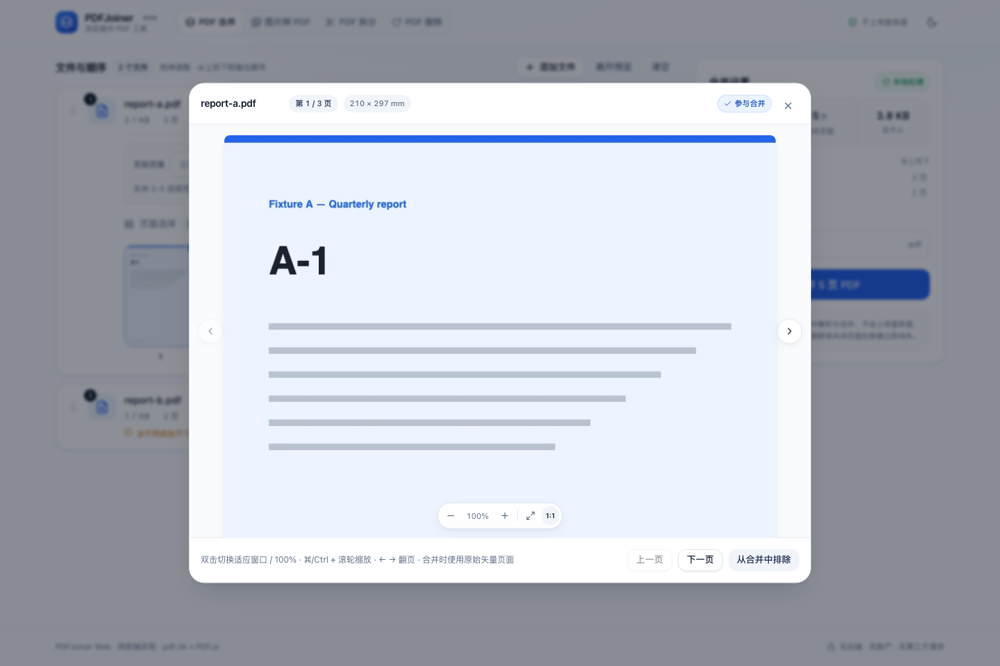
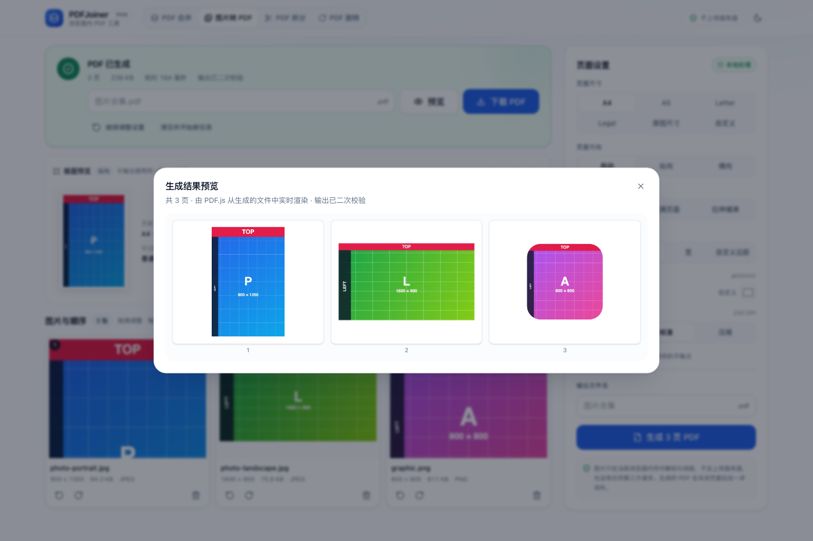
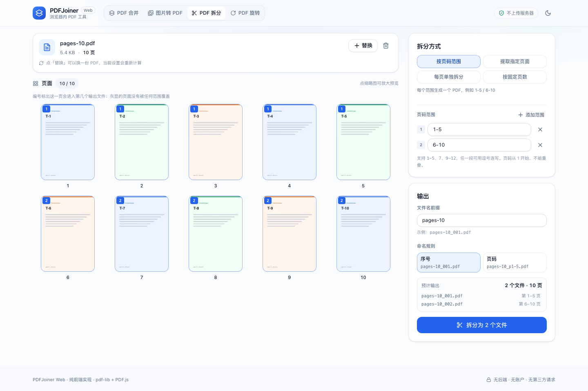
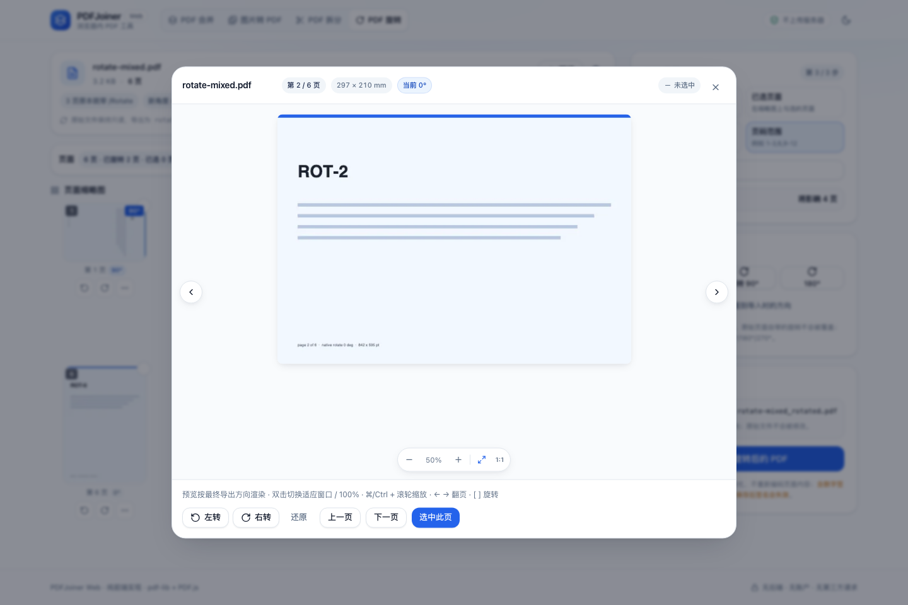
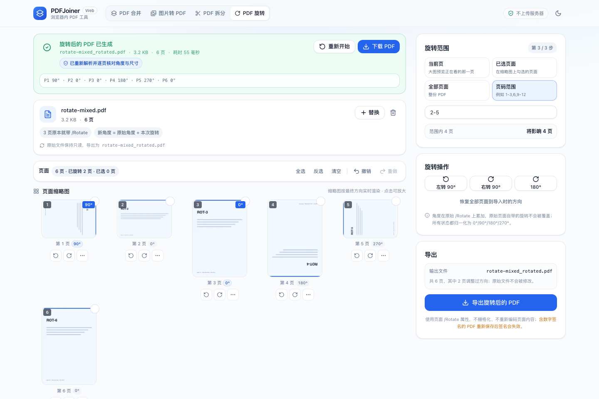

# PDFJoiner Web

浏览器内运行的四个 PDF 工具：**合并 PDF**、**图片转 PDF**、**PDF 拆分**、**PDF 页面旋转**。打开网页即可使用：不用注册、不用安装，文件 **不会离开这台设备**——解析、预览、排版、拆分、旋转、导出全部在当前标签页里完成。

> 合并功能是同名桌面版（Python + PySide6）的 Web 重写。合并引擎、页码规则与错误语义参考了旧版实现，但前端与浏览器 PDF 处理链路是全新写的。图片转 PDF、PDF 拆分与 PDF 页面旋转是同一个应用里陆续追加的三个工具，共用设计系统、pdf.js 预览链路与 pdf-lib 依赖。

## 四个工具

顶部导航切换，四个工具各自保留自己的文件与设置，互不影响：

| 工具 | 路由 | 说明 |
| --- | --- | --- |
| PDF 合并 | `#/merge` | 多份 PDF 排序、选页，按页面对象合并，保留矢量内容 |
| 图片转 PDF | `#/images` | 多张图片排序、旋转，按纸张与边距排版，每张一页 |
| PDF 拆分 | `#/split` | 一份 PDF 按范围 / 选页 / 逐页 / 固定页数拆成多份，可打包 ZIP |
| PDF 页面旋转 | `#/rotate` | 单页 / 选页 / 页码范围 / 全篇调整方向，可撤销重做，写入 `/Rotate` 而非转图片 |

合并工作区（浅色）：


合并预览弹窗支持缩放（下图 100%，页面从顶部开始、左右留白对称）：



图片转 PDF 工作区：左侧是「版面预览 + 图片网格」，右侧是页面设置。版面预览与最终输出调用**同一个排版函数**，改边距或适配方式时看到的裁切就是导出后的裁切。


生成结果可以直接用 PDF.js 回读（下图为上一步生成的 3 页 PDF 的真实渲染）：



PDF 拆分工作区：左侧是文档卡片与页面网格，右侧是拆分设置。缩略图上的编号就是「这一页会进入第几个输出文件」，右侧实时列出每个输出文件的文件名与页码范围。



拆分完成后逐个列出文件，可单独下载或打包 ZIP：


PDF 页面旋转工作区：左侧是文档卡、工具条与页面网格，右侧是旋转范围、操作和导出。缩略图按**最终导出方向**由 PDF.js 重新渲染，每页都带角度标签与左转 / 右转 / 更多操作按钮。


大图预览同样按最终方向渲染，并可在弹窗内直接旋转、缩放、翻页：



导出结果会列出每页最终角度、体积、耗时与逐页校验状态，再一键下载新 PDF：



## 快速开始

```bash
npm install

npm run dev          # 开发服务器 http://localhost:5173
npm run build        # 类型检查 + 生产构建，输出 dist/
npm run preview      # 本地预览 dist/（默认 4173 端口）

npm run test         # 单元测试（Vitest，220 个）
npm run test:e2e     # 端到端测试（Playwright，71 个用例 × 3 个内核）
npm run lint         # ESLint
npm run fixtures     # 重新生成测试用 PDF 样本
npm run fixtures:images  # 重新生成测试用图片样本（需要 Playwright 的 Chromium）
npm run fixtures:rotate  # 重新生成旋转专用样本（6 页混合方向 + 600 页长文档）
```

Node 版本要求：**>= 20**（开发时使用 22.22.2）。

首次跑端到端测试前需要下载浏览器内核：

```bash
npx playwright install chromium firefox webkit
```

## 功能：PDF 合并

**导入**
- 点击选择、一次多选、拖拽到页面任意位置
- 自动读取文件名 / 大小 / 页数
- 扩展名、空文件、体积上限（200 MB）、PDF 结构四层校验
- 重复文件（同名 + 同大小 + 同修改时间）自动跳过并提示
- 损坏文件、非 PDF 文件、加密文件分别给出可执行的错误说明

**文件管理**
- 卡片式列表，拖拽排序 + 上移/下移按钮（键盘可达）
- 单文件删除、一键清空
- 实时显示文件数、合并页数、输入总大小
- 侧栏「输出顺序」逐条列出最终拼接顺序

**页面预览与选择**
- PDF.js 渲染真实页面缩略图，页码标注
- 点击缩略图进入预览：可缩放 25%–300%，支持按钮、双击（适应窗口 ⇄ 100%）、`+`/`-`/`0` 快捷键、⌘/Ctrl + 滚轮（以光标为锚点），放大后可拖拽平移
- 预览中可翻页（← → 或按钮），显示纸张毫米尺寸与旋转角度
- 逐页勾选 / 取消，被排除的页面留位显示但置灰
- 页码输入框与缩略图选择双向同步；顺序自定义时缩略图左上角显示输出序号
- 按需渲染：首屏只挂载 60 个缩略图，横向滚动再追加；每个缩略图进入视口附近才开始渲染，渲染并发限制为 2

**合并与导出**
- pdf-lib 真实页面对象复制，保留矢量内容、原始页面尺寸与方向
- 页面范围：全部 / 单页 / 连续 / 多段 / 重复页
- 页面级进度（已完成 X / 共 Y 页），不使用伪造的字节百分比
- 可取消：在文件或每 25 页的批次边界响应取消
- 成功态显示页数、体积、耗时、是否二次校验，可改文件名后下载
- 「继续调整」保留文件，「清空并开始新任务」释放全部资源

**界面**
- 浅色/深色主题，跟随系统并记住选择
- 桌面两栏、移动端单栏 + 底部操作条
- 空 / 加载 / 读取中 / 处理中 / 成功 / 失败 六种状态都有独立设计

## 功能：图片转 PDF

**导入**
- 点击选择、一次多选、拖拽到页面任意位置、继续追加
- 用**文件头魔数**判断格式，不看扩展名：改了后缀的 PDF 会被拒绝，无后缀的真图片仍可用
- 支持 JPEG / PNG / WebP / BMP / GIF（取第一帧）；Safari 额外支持 HEIC/AVIF（由浏览器原生解码）
- 每张卡片显示缩略图、像素尺寸、体积、格式、输出序号；含透明通道的图片用棋盘格底衬
- 解码失败、无法识别的格式、超过 60 MB、超过 1.2 亿像素分别给出可执行的错误说明
- 重复图片（同名 + 同大小 + 同修改时间）自动跳过并提示

**图片管理**
- 卡片网格，拖拽排序（指针与键盘都可操作），顺序即 PDF 页面顺序
- 左旋 / 右旋 90°、单张删除、一键清空、继续添加
- 点击卡片浏览大图，可在预览里继续旋转与重置

**页面设置**
- 页面尺寸：A4 / A5 / Letter / Legal / 原图尺寸（按 DPI 换算，默认 300，可调 36–1200）/ 自定义（毫米）
- 页面方向：自动（按每张图片的宽高比逐页决定）/ 纵向 / 横向
- 图片适配：完整显示（contain）/ 填满页面（cover，超出内容区的部分被真实裁剪）/ 拉伸铺满（stretch）
- 页边距：无边距 / 普通 8 mm / 宽 18 mm / 自定义（毫米）
- 页面背景：白、浅灰、米白、深色或任意取色
- 输出质量：高质量（300 DPI 目标）/ 标准（200 DPI）/ 压缩（120 DPI），可按需直通原始字节

**生成与反馈**
- 每张图片一页，按排序输出；进度按**已处理张数**（`5 / 12 张`）而不是伪造的百分比
- 阶段区分「正在处理图片 → 正在写入 PDF → 正在校验输出」，可中途取消
- 成功态显示页数、体积、耗时与是否二次校验，可改文件名后下载
- 「预览」按钮用 PDF.js 把**生成出来的文件**逐页渲染出来，证明结果真的可读
- 手机端底部固定「生成 PDF」操作条，桌面端为右侧设置栏

## 功能：PDF 拆分

**导入**
- 点击选择、拖拽到页面任意位置，一次处理一份 PDF（单文件上限 200 MB）
- 用文件头魔数校验：改了后缀的文本文件会被拒绝并说明原因
- 加密 PDF 明确提示不支持；损坏文件在卡片上直接显示解析错误
- 随时「替换」成另一份 PDF，「移除」回到空状态

**四种拆分模式**

| 模式 | 输入 | 输出 |
| --- | --- | --- |
| 按页码范围 | 若干行范围，如 `1-5` / `6-10` / `11-15` | 每个范围一个 PDF |
| 提取指定页面 | `1,3,5,8-12`，或直接点选缩略图 | 一个 PDF，页序＝输入顺序 |
| 每页单独拆分 | 无 | 每页一个 PDF，编号 `_001`、`_002`… |
| 按固定页数 | 每份页数，如 5 | 每 5 页一份，最后一份不足也生成 |

**校验与提示**
- 页码从 1 开始；越界、倒序（`5-2`）、空项、无法识别的写法都会在对应输入框下方给出具体原因
- **范围重叠会直接阻止拆分**并列出冲突页码（同一页出现在两个文件里几乎总是笔误）
- 未被任何范围覆盖的页面以「提示」而非「错误」呈现，不阻止拆分
- 提取模式下重复页码自动去重，并在提示里说明忽略了哪几页

**页面预览**
- 用 PDF.js 渲染真实缩略图，按需加载；网格一次挂载 120 页，其余按需追加
- 缩略图角标就是输出文件序号，非提取模式下能把「这一页进第几个文件」一眼看清
- 点缩略图进入放大预览：可缩放 25%–300%、翻页、双击切换适应窗口 / 100%
- 提取模式下缩略图带勾选框，点选顺序即输出顺序

**输出**
- 文件名前缀与命名规则（`_001.pdf` 序号式，或 `_p1-5.pdf` 页码式）
- 实时列出每个输出文件的文件名与页码范围，以及「N 个文件 · M 页」
- 完成后逐个显示文件名、页数、体积，可单文件下载，也可打包成 ZIP
- 每个输出都会重新解析一次做校验，校验不过就整体失败，绝不显示假成功

## 功能：PDF 页面旋转（V1.3）

**导入**
- 点击选择、拖拽到页面任意位置，一次处理一份 PDF（单文件上限 200 MB）
- 检查扩展名、空文件、文件头魔数；加密 PDF 与损坏文件在文档卡上直接说明原因
- 导入时读取**每一页**的原始 `/Rotate`（不是只读前 60 页），页面自带旋转不会被覆盖
- 随时「替换」或「移除」；替换会清理旧任务、旧缩略图与历史栈

**页面网格**
- 每页显示真实缩略图、页码、当前最终角度、选中状态、左转 / 右转 / 更多操作
- 「更多操作」里有旋转 180°、恢复这一页的原始方向、放大预览
- 一次最多挂载 60 张卡片，缩略图用 IntersectionObserver 按需渲染；单页渲染失败不影响其它页
- 点击缩略图进入大图预览：可旋转、缩放 25%–300%、翻页、切换选中，关闭后状态保留

**四种操作范围**

| 范围 | 说明 |
| --- | --- |
| 当前页 | 大图预览正在看的那一页 |
| 已选页面 | 在网格里勾选的页面，可全选 / 反选 / 清空 |
| 全部页面 | 整份文档 |
| 页码范围 | `1-5`、`1-3,6,9-12` 等；重复页码在一次操作里只转一次 |

操作前明确显示「将影响 N 页」；范围写错时显示具体原因并禁用旋转按钮。角度一律归一化为 `0° / 90° / 180° / 270°`：

```ts
normalizedAngle = ((angle % 360) + 360) % 360
finalRotation   = normalize(originalRotation + rotationDelta)
```

**历史与重置**
- 撤销 / 重做（也可 `Ctrl/⌘ + Z`、`Ctrl/⌘ + Shift + Z`），历史栈最多 60 个快照
- 「恢复原始方向」回到**导入时**的角度，而不是把所有页强制设为 0°
- 任何一次编辑都会让上一次的导出结果失效，避免下载到过期文件

**导出**
- 默认文件名 `原文件名_rotated.pdf`，原始 `File` 对象始终只读
- 在独立 Web Worker 里 `PDFDocument.load` → `page.setRotation(degrees(finalAngle))` → `save`
- 只写角度发生变化的页面；内容流、MediaBox、文字、矢量图形、图片对象、页面顺序全部原样保留
- 输出小于 64 MB 时重新解析，逐页核对角度、尺寸与内容流；不一致就整体失败，不提供下载
- 真实分阶段进度（读取 / 应用 / 生成 / 校验 / 完成），按已处理页数统计，不做虚假百分比
- 取消同时走「协作式检查点 + 强制终止 worker」，保证卡在 `save()` 里也不会产出半成品

## 技术栈

| 层 | 选择 |
| --- | --- |
| 框架 | React 18 + TypeScript 5.9 + Vite 5 |
| 样式 | Tailwind CSS 3.4 + shadcn/ui 风格的本地组件（Radix 原语 + CVA） |
| PDF 引擎 | pdf-lib 1.17（合并、图片排版与拆分共用） |
| 页面预览 | pdfjs-dist 4.10（worker + 自托管 cMaps/标准字体） |
| 图片解码/编码 | `createImageBitmap` + `OffscreenCanvas`（不可用时降级到主线程 canvas） |
| 打包下载 | JSZip 3.10（按需动态加载，压缩方式 STORE） |
| 拖拽排序 | dnd-kit |
| 状态 | Zustand 5 |
| 通知 | sonner |
| 测试 | Vitest 2 + Playwright 1.64 |

没有任何后端、数据库、账号系统或云存储。构建产物是纯静态文件。

## 目录结构

```text
pdfjoiner-web/
├── index.html                    # 单页入口，含防主题闪烁的内联脚本
├── src/
│   ├── main.tsx                  # 挂载、Promise.withResolvers 兜底、全局拖拽拦截
│   ├── App.tsx                   # 路由分发（合并 / 图片 / 拆分 / 旋转）、布局骨架、通知
│   ├── index.css                 # 设计令牌（HSL 变量）、层级与工具类
│   ├── components/
│   │   ├── ui/                   # button, badge, card, dialog, input, progress, tooltip
│   │   ├── layout/               # app-header、app-footer、hero、tool-nav（四个工具切换）
│   │   ├── upload/               # drop-zone（PDF / 图片两种模式）
│   │   ├── files/                # 【合并】file-list（dnd-kit）、file-card、range-editor
│   │   ├── pages/                # 【公共】page-strip、page-thumb、page-preview-dialog（支持旋转适配）
│   │   ├── merge/                # 【合并】merge-panel（汇总 / 进度 / 结果卡）
│   │   ├── images/               # 【图片】网格、卡片、设置面板、版面预览、结果卡、结果 PDF 预览
│   │   ├── split/                # 【拆分】文档卡、模式切换、范围编辑器、页面网格、设置、结果
│   │   ├── rotate/               # 【旋转】空状态、文档卡、页面卡片、网格、工具条、设置、结果、编排
│   │   ├── workspace.tsx         # 【合并】两栏布局编排
│   │   ├── images/image-workspace.tsx  # 【图片】两栏布局编排
│   │   ├── split/split-workspace.tsx   # 【拆分】两栏布局编排 + 预览弹窗接线
│   │   └── rotate/rotate-workspace.tsx # 【旋转】两栏布局编排 + 预览/旋转接线
│   ├── features/
│   │   ├── pdf/                  # 【合并】
│   │   │   ├── engine.ts         #   纯函数层：inspect + merge（无 DOM 依赖，可在 Node 跑）
│   │   │   ├── engine-client.ts  #   主线程 RPC、字节按需投喂、worker 生命周期
│   │   │   ├── protocol.ts       #   主线程 ↔ worker 的消息类型
│   │   │   └── errors.ts         #   错误码与错误类型（错误文案的单一来源）
│   │   ├── image-pdf/            # 【图片】
│   │   │   ├── types.ts          #   设置项、纸张预设、质量档位、单位换算
│   │   │   ├── page-layout.ts    #   纯函数排版：页面尺寸 / 方向 / 适配 / 边距（预览与引擎共用）
│   │   │   ├── encode.ts         #   canvas 归一化：旋转、透明、目标像素、JPEG 直通判定
│   │   │   ├── build.ts          #   pdf-lib 组装：背景、裁剪路径、嵌入与二次校验
│   │   │   ├── format.ts         #   魔数识别 + 透明通道判定
│   │   │   ├── source.ts         #   解码（createImageBitmap →  兜底）
│   │   │   ├── inspect.ts        #   导入前的尺寸 / 格式 / 像素上限检查
│   │   │   ├── client.ts         #   worker 或主线程双通道，能力探测与取消
│   │   │   ├── protocol.ts       #   主线程 ↔ 图片 worker 的消息类型
│   │   │   └── errors.ts
│   │   ├── pdf-split/            # 【拆分】
│   │   │   ├── types.ts          #   模式、设置、输出的类型与文案
│   │   │   ├── plan.ts           #   纯函数：四模式 → 输出文件清单（UI 与 worker 共用）
│   │   │   ├── engine.ts         #   一次加载源文档，逐份 copyPages + save + 校验
│   │   │   ├── client.ts         #   拆分 worker 的主线程 RPC、取消、生命周期
│   │   │   ├── protocol.ts       #   主线程 ↔ 拆分 worker 的消息类型
│   │   │   └── zip.ts            #   JSZip 打包（STORE，按需动态加载）
│   │   ├── pdf-rotate/           # 【旋转】
│   │   │   ├── types.ts          #   角度、范围、进度、结果、检查结果的共享类型
│   │   │   ├── rotation.ts       #   纯函数：归一化、finalRotation、批量/重置、导出计划
│   │   │   ├── history.ts        #   纯函数：撤销/重做快照栈（上限 60）
│   │   │   ├── engine.ts         #   一次解析读全量 /Rotate；setRotation + save + 逐页校验
│   │   │   ├── client.ts         #   主线程 RPC、协作取消 + 强制终止、worker 生命周期
│   │   │   └── protocol.ts       #   主线程 ↔ 旋转 worker 的消息类型
│   │   ├── page-range/           # 【合并】【拆分】【旋转】页码解析与格式化
│   │   └── preview/thumbnail-service.ts  # pdf.js 文档缓存、按最终角度渲染、LRU、单页缓存失效
│   ├── store/
│   │   ├── use-app-store.ts      # 【合并】文件、选择、合并状态
│   │   ├── use-image-store.ts    # 【图片】图片、设置、生成状态、对象 URL 生命周期
│   │   ├── use-split-store.ts    # 【拆分】文档、设置、选择、构建状态
│   │   ├── use-rotate-store.ts   # 【旋转】文档、delta 历史、范围、选择、导出状态、任务令牌
│   │   └── selectors.ts          # 【合并】汇总、门禁、结构风险提示
│   ├── hooks/                    # use-theme, use-file-drop, use-in-view
│   ├── workers/
│   │   ├── pdf.worker.ts         # 【合并】合并与解析 worker
│   │   ├── image.worker.ts       # 【图片】解码 + OffscreenCanvas 编码 + 组装
│   │   ├── split.worker.ts       # 【拆分】拆分 worker
│   │   └── rotate.worker.ts      # 【旋转】读取全量角度 + 旋转导出 worker
│   └── lib/                      # utils、constants（上限与阈值）、use-route（hash 路由）
├── public/
│   ├── pdfjs/cmaps/              # 1.6 MB，避免向 CDN 请求中文字体映射
│   ├── pdfjs/standard_fonts/     # 800 KB
│   └── _headers                  # Cloudflare Pages 安全响应头
├── scripts/
│   ├── make-fixtures.mjs         # 用 pdf-lib 生成 PDF 测试样本
│   ├── make-fixtures-pypdf.py    # 用 pypdf 生成加密 / 书签 / 注释样本
│   ├── make-image-fixtures.mjs   # 用 Chromium 编码 JPG/PNG/WebP，并手写 BMP/GIF 样本
│   └── make-rotate-fixture.mjs   # 用 pdf-lib 生成 6 页混合方向 + 600 页长文档样本
├── tests/
│   ├── unit/                     # 14 个测试文件 + PDF 内容流 / PNG 生成辅助
│   ├── e2e/
│   │   ├── app.spec.ts           # 【合并】15 个用例
│   │   ├── images.spec.ts        # 【图片】20 个用例
│   │   ├── split.spec.ts         # 【拆分】17 个用例
│   │   └── rotate.spec.ts        # 【旋转】19 个用例
│   └── fixtures/
│       ├── *.pdf                 # 样本（含加密 / 损坏 / 10 页 / 100 页 / 300 页 / 旋转 600 页）
│       └── images/               # 图片样本（含透明 PNG / 大图 / 损坏 / 非图片）
├── docs/screenshots/             # 实际运行截图（由 e2e 用例生成）
├── dist/                         # 构建产物（npm run build 生成）
├── vite.config.ts                # 别名、worker 格式、pdf.js 单独分包
├── vitest.config.ts
├── playwright.config.ts          # 3 个浏览器项目，自动构建 + 预览
└── vercel.json
```

## 本次新增与修改的文件

### V1.3 — PDF 页面旋转

在现有工程内增量扩展：没有新建项目、没有替换技术栈、没有改动合并 / 图片 / 拆分三条链路的业务行为。开发在 `main` 上进行（按项目 Git 规范不使用功能分支）。

**新增（24 个源码 / 测试 / 样本文件，另有验收报告与 8 张截图）**

| 路径 | 作用 |
| --- | --- |
| `src/features/pdf-rotate/types.ts` | 角度 / 范围 / 进度 / 输出 / 检查结果的共享类型 |
| `src/features/pdf-rotate/rotation.ts` | 纯函数：角度归一化、`finalRotation`、批量与重置、导出计划 |
| `src/features/pdf-rotate/history.ts` | 纯函数：撤销 / 重做快照栈 |
| `src/features/pdf-rotate/engine.ts` | 读全量 `/Rotate`、`setRotation`、`save`、输出逐页校验、取消检查点 |
| `src/features/pdf-rotate/protocol.ts` | 主线程 ↔ 旋转 worker 的消息类型 |
| `src/features/pdf-rotate/client.ts` | 主线程 RPC、协作取消 + 强制终止、worker 生命周期 |
| `src/workers/rotate.worker.ts` | 独立的旋转 worker |
| `src/store/use-rotate-store.ts` | delta 单一真相、范围解析、选择、历史、导出任务与令牌 |
| `src/components/rotate/rotate-workspace.tsx` | 两栏编排、预览弹窗接线、快捷键、移动端底栏 |
| `src/components/rotate/rotate-hero.tsx` | 空状态与拖拽上传 |
| `src/components/rotate/rotate-upload.tsx` | 文档卡（名称 / 大小 / 页数 / 原生旋转提示 / 结构风险） |
| `src/components/rotate/rotate-page-card.tsx` | 单页卡片（按最终角度渲染、选中、左右转、更多操作） |
| `src/components/rotate/rotate-page-grid.tsx` | 分批挂载的页面网格 |
| `src/components/rotate/rotate-toolbar.tsx` | 选择、统计、撤销 / 重做 |
| `src/components/rotate/rotate-settings.tsx` | 范围选择、页码输入、批量旋转、导出 |
| `src/components/rotate/rotate-result.tsx` | 进度、成功 / 失败 / 取消、下载 |
| `tests/unit/rotate-rotation.test.ts` | 18 个：角度表、批量 / 重置 / 导出计划、撤销重做栈 |
| `tests/unit/rotate-engine.test.ts` | 18 个：字节级 `/Rotate`、内容 / 尺寸 / 页序、异常、进度、取消、校验 |
| `tests/unit/rotate-pdfjs.test.ts` | 3 个：用 PDF.js 独立复核角度、viewport 换向、文本与页序 |
| `tests/unit/rotate-store.test.ts` | 26 个：导入 / 范围 / 选择 / 编辑 / 历史 / 导出 / 竞态 / 清理 |
| `tests/e2e/rotate.spec.ts` | 19 个：真实浏览器全流程、下载文件复核、隐私与响应式、截图 |
| `scripts/make-rotate-fixture.mjs`、`tests/fixtures/rotate-mixed.pdf`、`tests/fixtures/rotate-large.pdf` | 旋转专用样本与生成脚本 |

**修改（10 个代码 / 文档文件 + 20 张既有截图重生成，均为最小改动）**

| 路径 | 改动 |
| --- | --- |
| `src/lib/use-route.ts` | `ToolRoute` 增加 `rotate`，路由表四项 |
| `src/components/layout/tool-nav.tsx` | 增加「PDF 旋转」导航项；小屏内边距收紧以容纳第四个入口 |
| `src/components/layout/app-header.tsx` | 小屏隐藏 logo 文字，避免四个导航项造成横向溢出 |
| `src/App.tsx` | 四路分发、第四路资源释放与 `beforeunload` 保护 |
| `src/lib/constants.ts` | `rotateThumbnailWidth`、`rotateHistoryLimit` |
| `src/features/pdf/engine.ts` | 抽出 `inspectDocument(doc)`（原逻辑不变），让旋转 worker 一次解析即可同时拿到全量角度与检查信息 |
| `src/features/preview/thumbnail-service.ts` | `getThumbnail` / `getPageSize` / `peek` 增加可选最终角度，缓存键包含角度，新增 `releasePage()`；不传角度时行为与旧版一致 |
| `src/components/pages/page-preview-dialog.tsx` | 新增可选 `rotation` 适配器（按最终角度渲染、显示角度、弹窗内旋转）；不传时行为与旧版一致 |
| `index.html`、`package.json` | 标题 / 描述 / 版本号、`fixtures:rotate` 脚本 |
| `docs/screenshots/01`–`20`（20 张 PNG） | 顶部导航新增第四项后，全量 e2e 的截图用例在 Chromium 中重新生成既有截图，保证文档与当前 UI 一致；不是手工修改 |

`README.md` 与 `docs/V1.3-验收报告.md` 同步更新。截图 `21`–`28` 由 e2e 截图用例在真实 Chromium 中生成。

### V1.2 — PDF 拆分

同样是在现有工程内扩展：没有新建项目、没有替换技术栈、没有改动合并与图片两条链路的行为。

**新增**

| 路径 | 作用 |
| --- | --- |
| `src/features/pdf-split/types.ts` | 拆分模式、设置、输出文件的类型，以及四个模式的文案 |
| `src/features/pdf-split/plan.ts` | **纯函数拆分计划**：模式 + 设置 → 输出文件清单（含重叠/越界/命名），UI 与引擎共用 |
| `src/features/pdf-split/engine.ts` | pdf-lib 拆分：一次加载源文档，逐份 `copyPages` + `save` + 逐份校验，无 DOM 依赖 |
| `src/features/pdf-split/client.ts` | 拆分 worker 的主线程 RPC、协作式取消、任务结束即 `terminate()` |
| `src/features/pdf-split/protocol.ts` | 主线程 ↔ 拆分 worker 的消息类型 |
| `src/features/pdf-split/zip.ts` | JSZip 打包（`STORE`，按需 `import()`） |
| `src/workers/split.worker.ts` | 拆分 worker，文件字节一次转移进入 |
| `src/store/use-split-store.ts` | 文档、设置、提取模式的有序选择、构建状态、取消、释放 |
| `src/components/split/split-hero.tsx` | 空状态 |
| `src/components/split/document-card.tsx` | 文档卡：名称 / 体积 / 页数 / 结构风险提示 / 替换 / 移除 |
| `src/components/split/mode-tabs.tsx` | 四种模式切换（`aria-pressed`） |
| `src/components/split/range-list.tsx` | 范围行编辑：增删、行内错误 |
| `src/components/split/page-grid.tsx` | 页面网格：输出序号角标、按需挂载、点选 |
| `src/components/split/settings-panel.tsx` | 设置面板：模式、命名、计划预览、错误与提示、执行按钮 |
| `src/components/split/result-panel.tsx` | 进度 / 成功 / 失败三态，单文件下载与 ZIP |
| `src/components/split/split-workspace.tsx` | 两栏编排、移动端底部操作条、预览弹窗接线 |
| `tests/unit/split-plan.test.ts` | 26 个计划用例 |
| `tests/unit/split-engine.test.ts` | 19 个引擎用例（页数、页序、页面框、矢量、进度、取消、加密/损坏/越界，以及注释/书签/表单的实测结论） |
| `tests/unit/split-pdfjs.test.ts` | 4 个用例：用 **PDF.js** 重新打开输出，核对页数、页序与页面内容 |
| `tests/e2e/split.spec.ts` | 17 个端到端用例 |
| `tests/fixtures/pages-10.pdf`、`pages-100.pdf` | 带页码标签的样本，用于逐页内容核对 |
| `docs/screenshots/14–20-*.png` | 新增的运行截图 |

**修改**

| 路径 | 改动 |
| --- | --- |
| `src/lib/use-route.ts` | 路由类型增加 `split`，解析改为白名单匹配 |
| `src/components/layout/tool-nav.tsx` | 增加第三项「PDF 拆分」 |
| `src/App.tsx` | 三路渲染；`beforeunload` 与卸载释放同时覆盖三套状态 |
| `src/components/pages/page-thumb.tsx` | 新增 `size`（网格用 132px）与 `showToggle`（非提取模式隐藏勾选框） |
| `src/components/pages/page-preview-dialog.tsx` | 新增可选 `selection` 适配器与 `hideToggle`，合并侧的默认行为不变；props 类型放宽为结构化的 `PreviewDocument` |
| `src/features/pdf/engine-client.ts` | 修复潜在竞态：`releaseWhenIdle()` 不再在合并进行中终止 worker |
| `src/lib/constants.ts` | 追加拆分上限（输出份数、每份页数、网格缩略图宽度） |
| `src/lib/utils.ts` | 新增 `triggerBlobDownload()`（下载后延时释放 object URL） |
| `scripts/make-fixtures.mjs` | 新增 10 页 / 100 页带标签样本 |
| `index.html` | 标题与描述覆盖三个工具 |
| `package.json` | 新增依赖 `jszip` |
| `README.md` | 本文 |

**未改动**：`src/features/pdf/engine.ts`、`src/features/image-pdf/*`、`src/store/use-app-store.ts`、`src/store/use-image-store.ts`、`src/components/merge/*`、`src/components/files/*`、`src/components/images/*`、`src/workers/pdf.worker.ts`、`src/workers/image.worker.ts`、`vite.config.ts`、设计令牌。合并与图片两组端到端用例全部保持通过。

### V1.1 — 图片转 PDF

图片转 PDF 是在现有工程内扩展的，没有新建项目、没有替换技术栈，也没有改动合并引擎的行为。

**新增**

| 路径 | 作用 |
| --- | --- |
| `src/lib/use-route.ts` | 极简 hash 路由（`#/merge`、`#/images`），用 `useSyncExternalStore` 订阅 `hashchange` |
| `src/components/layout/tool-nav.tsx` | 顶栏工具切换（真实 `<a href>`，支持中键与浏览器前进后退） |
| `src/components/images/image-workspace.tsx` | 图片工具的两栏编排、拖拽落区、移动端底部操作条 |
| `src/components/images/image-hero.tsx` | 空状态（含图片模式的拖放区） |
| `src/components/images/image-grid.tsx` | 卡片网格 + dnd-kit 排序（指针命中判定） |
| `src/components/images/image-card.tsx` | 单张图片卡片：缩略图、序号、拖拽手柄、旋转、删除、预览入口 |
| `src/components/images/image-preview-dialog.tsx` | 大图预览与旋转 |
| `src/components/images/rotated-image.tsx` | 按旋转角正确占位的图片组件（fill / contain 两种模式） |
| `src/components/images/page-layout-preview.tsx` | 版面预览：纸张、边距参考线、按内容区裁剪 |
| `src/components/images/settings-panel.tsx` | 页面尺寸 / 方向 / 适配 / 边距 / 背景 / 质量 / 文件名 / 进度 |
| `src/components/images/option-group.tsx` | 分段选择控件（`aria-pressed`） |
| `src/components/images/image-result-card.tsx` | 成功态、文件名、下载、预览入口 |
| `src/components/images/generated-pdf-dialog.tsx` | 用 PDF.js 渲染生成结果 |
| `src/features/image-pdf/types.ts` | 设置类型、纸张预设、质量档位、单位换算 |
| `src/features/image-pdf/page-layout.ts` | **预览与引擎共用的**排版纯函数 |
| `src/features/image-pdf/format.ts` | 魔数识别、透明通道判定、格式标签 |
| `src/features/image-pdf/encode.ts` | 旋转绘制、目标像素、直通判定、canvas 导出 |
| `src/features/image-pdf/source.ts` | 解码（`createImageBitmap` → `` 兜底） |
| `src/features/image-pdf/inspect.ts` | 导入前的格式/尺寸/像素上限校验 |
| `src/features/image-pdf/build.ts` | pdf-lib 组装：背景、裁剪、嵌入、二次校验 |
| `src/features/image-pdf/protocol.ts` | 主线程 ↔ 图片 worker 的消息类型 |
| `src/features/image-pdf/client.ts` | worker / 主线程双通道与取消 |
| `src/features/image-pdf/errors.ts` | 错误码与错误类型 |
| `src/store/use-image-store.ts` | 图片、设置、生成状态与对象 URL 生命周期 |
| `src/workers/image.worker.ts` | 解码 + OffscreenCanvas 编码 + 组装 |
| `scripts/make-image-fixtures.mjs` | 用 Chromium 生成图片样本（BMP 手写、GIF 内置） |
| `tests/unit/image-layout.test.ts` | 19 个排版几何用例 |
| `tests/unit/image-encode.test.ts` | 11 个编码/矩阵用例 |
| `tests/unit/image-build.test.ts` | 11 个组装用例 |
| `tests/unit/helpers/png.ts` | 纯 Node 的 PNG 生成器（测试用真 PNG 嵌入） |
| `tests/e2e/images.spec.ts` | 20 个端到端用例 |
| `tests/fixtures/images/*` | 10 个图片样本（含透明、大图、损坏、非图片） |
| `docs/screenshots/08–13-*.png` | 新增的运行截图 |

**修改**

| 路径 | 改动 |
| --- | --- |
| `src/App.tsx` | 按路由渲染两个工具；`beforeunload` 与资源释放同时覆盖两套状态 |
| `src/components/layout/app-header.tsx` | 加入工具切换，副标题改为「浏览器内 PDF 工具」 |
| `src/components/upload/drop-zone.tsx` | 增加 `kind` / `accept` / 文案 props，PDF 模式的行为与文案保持不变 |
| `src/lib/constants.ts` | 追加图片相关的上限（数量、单张体积、像素、画布） |
| `tests/unit/helpers/pdf.ts` | 增加 `pageContent` / `imageXObjects` / `imagePixelSize` 辅助函数 |
| `index.html` | 标题与描述覆盖两个工具 |
| `package.json` | 新增 `fixtures:images` 脚本 |
| `README.md` | 本文 |

**未改动**：`src/features/pdf/*`、`src/store/use-app-store.ts`、`src/store/selectors.ts`、`src/components/merge/*`、`src/components/files/*`、`src/components/pages/*`、`src/workers/pdf.worker.ts`、`vite.config.ts`、`tailwind.config.ts`、设计令牌。合并功能的 15 个端到端用例与 65 个单元测试全部保持通过。

## 工作原理

### 1. 导入与校验

一个文件要经过四道检查才会进入列表：

1. 扩展名必须是 `.pdf`；
2. 大小不能为 0、不能超过 200 MB；
3. 同名 + 同大小 + 同修改时间视为重复，直接跳过；
4. 交给 worker 用 pdf-lib 真正解析一次——解析失败的进「无法处理」，抛 `EncryptedPDFError` 的进「已加密」。

第 4 步同时拿到页数、页面尺寸、是否存在 AcroForm / 数字签名 / 书签 / 注释，用于在卡片上提前告知「合并后会丢失什么」。

### 2. 合并引擎

`src/features/pdf/engine.ts` 是纯函数层，不碰 DOM，因此同一份代码既跑在 worker 里，也跑在 Node 的单测里。

```ts
const out = await PDFDocument.create();
for (const plan of plans) {
  const source = await PDFDocument.load(bytes);
  for (let i = 0; i < plan.pages.length; i += 25) {
    const copied = await out.copyPages(source, plan.pages.slice(i, i + 25));
    copied.forEach((page) => out.addPage(page));
    // 每批让出事件循环，取消与进度才能插进来
    await new Promise((r) => setTimeout(r, 0));
  }
}
```

关键点：

- **页面对象复制**，不是截图、不是二进制拼接。输出页保留 `/MediaBox`、`/Rotate`、`/Resources`，文字仍是文字，图形仍是矢量。
- 分 25 页一批，批间 `await` 一次宏任务，取消信号与进度事件才有机会被处理。
- 输出页数与计划页数不符时直接报错，不产出文件。
- 小于 64 MB 的输出会被重新解析一次做**二次校验**（页数比对）；更大的输出跳过校验并在界面标注「未做二次校验」，如实告知而不是假装验证过。
- 元数据：Producer/Creator 写入 `PDFJoiner Web`，标题取用户填写的输出名；单文件合并时沿用源文档的 Author/Subject/Keywords。

### 3. Worker 协议（按需投喂字节）

一次性把所有 PDF 塞进 worker，峰值内存 = 全部输入 + 输出。这里改成**主线程按需投喂**：

```text
主线程                         Worker
  │ merge {files:[{name,pages}]} │
  │─────────────────────────────▶│
  │◀───────── need-bytes(index) ─│   “把第 0 个文件的字节给我”
  │  file.arrayBuffer()          │
  │──── merge-bytes(transfer) ──▶│   零拷贝转移，主线程立即释放
  │◀──────────── progress ───────│
  │◀────────── merge-result ─────│   ArrayBuffer 转移回主线程
```

于是峰值内存约为「输出 + 当前这一个输入」，而不是「输出 + 所有输入」。合并结束或取消后 worker 直接 `terminate()`，pdf-lib 的内部对象一并回收。

### 4. 缩略图

`thumbnail-service.ts` 管理三件事：

- **文档**：每个文件一个 pdf.js `PDFDocumentProxy`，按文件 id 索引，删除文件时 `destroy()`；
- **并发**：信号量限制同时渲染 2 页，避免主线程被 canvas 绘制挤满；
- **缓存**：LRU 最多 180 条 data URL，键包含目标宽度（104 px 的缩略图与 720 px 的预览互不覆盖）。

组件侧用 `IntersectionObserver` 在元素进入视口前 360 px 才发起渲染；页面条首屏只挂载 60 个节点，滚动接近末尾再追加 60 个。因此 300 页文档不会一次性渲染 300 张图。

pdf.js 本身通过 `import()` 动态加载，只有用户真正展开页面时才下载这个约 360 KB 的 chunk。

### 5. 内存与资源释放

| 资源 | 释放时机 |
| --- | --- |
| pdf-lib worker 及其内存 | 每次合并结束 / 取消 / 清空（`terminate()`） |
| 输出 Blob URL | 重新合并、修改文件、点「继续调整」、清空、组件卸载 |
| pdf.js 文档 | 删除单个文件、清空、页面卸载 |
| 缩略图 data URL | LRU 淘汰或文件被删除 |
| 输入字节 | 每次 `getBytes` 都是新读一份，传给 worker 后立即转移所有权，主线程不留副本 |

## 工作原理：图片转 PDF

### 1. 一套排版，两处使用

`src/features/image-pdf/page-layout.ts` 只有一个纯函数：

```ts
computePageLayout({ settings, imageWidth, imageHeight, rotation })
// → { pageWidth, pageHeight, contentBox, imageBox, clipped, orientation }
```

界面上的版面预览与 pdf-lib 组装都调用它。预览把返回的 `imageBox` 换算成**页面盒子的百分比**去绝对定位，引擎把同一组数值写进 `drawImage` 的坐标——不存在「预览一套、导出一套」的第二份实现。

页面尺寸的三条换算规则：

| 页面尺寸 | 规则 |
| --- | --- |
| A4 / A5 / Letter / Legal | 固定毫米值，`mm × 72 / 25.4` 转点 |
| 原图尺寸 | `像素 / DPI × 25.4` 得到毫米，默认 300 DPI；页面永远按**旋转后**的像素算 |
| 自定义 | 用户输入的毫米值，限制在 20–2000 mm |

方向：`自动` 比较图片宽高比与纸张，必要时横竖互换；`纵向` / `横向` 强制页面，再由适配方式决定留白。边距换算成点后夹紧到「至少留 4 mm 内容区」，避免用户输入 400 mm 边距时算出负尺寸。

### 2. 编码策略：能不重编码就不重编码

| 情形 | 处理 | 结果 |
| --- | --- | --- |
| JPEG，无需旋转，目标像素 ≥ 原图 | **原字节直通** | 无损，`source: 'original'` |
| PNG（含透明），同上 | 原字节直通 | 透明通道随 `/SMask` 一起保留 |
| 需要旋转 / 缩小 / 格式转换 | canvas 归一化后重编码 | 有损，质量随档位 |
| 不透明图片 | 输出 JPEG（0.95 / 0.86 / 0.72） | 「压缩」档主要靠这一步变小 |
| 含透明通道 | 输出 PNG（永不转 JPEG） | 透明不会被拍成白/黑底 |

「目标像素」由 `imageBox` 的物理宽度 × 档位 DPI 得到，并**永不超过原始像素**（不放大）。旋转 90°/270° 会在 canvas 上真实重排像素，页面尺寸也随之从纵向变横向——不是给查看器加一个旋转标记。

### 3. 裁剪：`cover` 要裁在内容区，而不是页面边缘

PDF 查看器只保证裁到页面边界；「填满页面」+ 页边距时，图片必须裁在**内容区**，否则会溢到留白里。pdf-lib 的高层 API 没有裁剪，这里直接用内容流操作符：

```ts
page.pushOperators(
  pushGraphicsState(),
  rectangle(box.x, box.y, box.width, box.height),
  clip(),
  endPath(),
);
page.drawImage(image, { x, y, width, height });   // 超出部分被上面的路径裁掉
page.pushOperators(popGraphicsState());
```

单元测试把内容流解压后，用正则取出 `… re W n` 的四个数值，与 `contentBox` 逐项比对；同时断言图片实际绘制尺寸**大于**裁剪框（证明真的发生了裁剪，而不是缩小到刚好放下）。

### 4. 双通道：worker 优先，主线程兜底

```text
canEncodeOffscreen() ?
  ├─ true  → image.worker：createImageBitmap + OffscreenCanvas + pdf-lib，主线程只收最终字节
  └─ false → 主线程：同样的 buildImagePdf，只把 canvas 工厂换成 <canvas>
```

两条通道共用 `buildImagePdf` 与 `encodeImage`，唯一的差别是画布来源。降级时界面会明确提示「当前浏览器缺少 OffscreenCanvas，图片会在主线程处理」。`images.spec.ts` 里有一个用例用 `Object.defineProperty(window, 'OffscreenCanvas', …)` 把 API 抹掉，真实跑通这条降级路径。

Blob 通过结构化克隆按引用传给 worker（不复制字节），编码完成后立即 `bitmap.close()` 并把 canvas 宽高置 1，峰值内存约为「当前这一张 + 输出的图片对象」。

### 5. 进度、取消与校验

- 进度以**图片张数**为单位（`5 / 12 张`），阶段为 `encoding → saving → verifying`；没有伪造的字节百分比。
- 每处理 4 张让出一次事件循环，取消消息才有机会被 worker 读到；取消在图片边界生效。
- 输出会被重新 `PDFDocument.load()` 一次：页数不符直接抛错（绝不产出「失败但显示成功」的结果），页面尺寸与预期不一致则把 `verified` 置为 `false`。
- 生成结束后 worker `terminate()`，pdf-lib 的内部对象随之回收。

## 工作原理：PDF 拆分

### 1. 计划与执行分离

`src/features/pdf-split/plan.ts` 里的 `buildSplitPlan(pageCount, settings)` 是纯函数，输入「页数 + 模式 + 设置」，输出**将要生成的每个文件**：文件名、0-based 页码数组、人类可读的页码范围。

界面用它画「预计输出」和按钮文案，worker 用它当复制清单，单元测试直接调它。因此不可能出现「界面说 4 个文件、实际生成 5 个」这种偏差——两处是同一份计算。

页码约定与合并工具一致：**用户输入 1-based，计划里一律 0-based**。转换只发生在 `plan.ts` 和 `describePages()` 两个地方。

### 2. 一份文档只解析一次

```ts
const source = await PDFDocument.load(bytes);        // 只做一次
for (const job of jobs) {
  const out = await PDFDocument.create();
  for (批量 25 页) await out.copyPages(source, batch);  // 只复制页面对象
  const saved = await out.save({ useObjectStreams: true });
  // 立刻重新 load 一遍，页数不符就整体失败
}
```

把 300 页拆成 300 个文件，只有 1 次源解析 + 300 次小文档序列化，而不是 300 次源解析。每批之间 `await setTimeout(0)`，取消请求才有机会被 worker 读到。

### 3. 页面对象复制，不是二进制切片

`copyPages` 复制的是页面字典及其引用的资源：MediaBox、`/Rotate`、字体、矢量操作符、图片 XObject 都会跟着走。所以：

- 原来横向的页面拆分后仍然横向（单元测试断言 `841.89 × 595.28`）；
- 页面里仍然是 `BT … Tj` 文本算子，没有 Image XObject（断言 `imageXObjectNames()` 为空）；
- 不会出现「清晰度下降」——根本没有重新光栅化这一步。

反过来，页面之外的结构不会被带过去，这一点在下面的「已知限制」里逐条写清楚。

### 4. Worker、字节转移与取消

文件字节通过 `postMessage` 的 transfer 列表**转移**给 worker（不是复制），源文档全程留在 worker 里；主线程只收最终产物。取消是协作式的：`shouldCancel()` 在每批页面和每个输出文件之前检查，取消后不产出任何文件，也不报「成功」。

### 5. 为什么 ZIP 用 STORE 而不是 DEFLATE

PDF 内部的对象流本来就是压缩过的，再 deflate 一遍通常只省 1–2%，却要在主线程消耗可观 CPU。所以 ZIP 以 `compression: 'STORE'` 打包：解出来的字节与单独下载的文件**完全一致**，这也让端到端测试可以用 JSZip 解包后直接解析 PDF 来核对。JSZip 本身是 `await import()` 的，不进首屏包。

## 工作原理：PDF 旋转

### 1. 三个角度，一套公式

必须区分源 PDF 已有的 `/Rotate`、用户本次增加的 delta、以及最终写进文件的绝对角度。混淆它们会让「原本就旋转 90° 的页」被误设成 90°，等于什么都没做。

```text
original  = 源 PDF 第 i 页的 /Rotate        （导入时逐页读取）
delta     = 用户在本次会话中累加的角度      （历史栈里存的就是它）
final     = normalize(original + delta)     （缩略图、弹窗、导出共用）
```

`normalize` 用 `((angle % 360) + 360) % 360`，配合 `0/90/180/270` 白名单，界面上永远不可能出现 360° 或 450°。`rotation.ts` 是无 DOM、无 pdf-lib 依赖的纯函数，因此角度表可以直接单测。

### 2. 只写 /Rotate，不碰内容

```ts
const doc = await PDFDocument.load(bytes, { updateMetadata: false });
const pages = doc.getPages();
for (const { pageIndex, finalAngle } of jobs) {
  if (finalAngle !== originals[pageIndex]) {
    pages[pageIndex].setRotation(degrees(finalAngle));
  }
}
const produced = await doc.save({ useObjectStreams: true, addDefaultPage: false });
```

没有 `drawPage`、没有 canvas、没有 PNG/JPEG 中间产物。内容流、文字、矢量图形、图片 XObject、MediaBox、页面顺序全部原样保留；90° / 270° 在阅读器里显示的宽高会互换，但 **MediaBox 不被改写**，这是 PDF 规范里 `/Rotate` 的语义。引擎在写出前先校验整个计划（越界索引、非法角度一律拒绝），只写角度真正变化的页。

### 3. 预览是真渲染，不是 CSS 转图

`thumbnail-service.ts` 的 `getThumbnail(..., rotation)` 把**最终绝对角度**传给 PDF.js 的 `getViewport({ scale, rotation })`，由 PDF.js 生成旋转后的位图。缓存键是 `文档 ID : 页码 : 宽度 : 角度`，所以旋转后不会命中旧位图；`releasePage()` 只清掉这一页的旧缓存，不必整份文档重渲。

端到端测试直接断言 `` 的 `naturalWidth / naturalHeight` 在旋转 90° 后发生换向——纯 CSS `transform` 是做不到的。共享的大图预览弹窗通过可选的 `rotation` 适配器接同一套角度，支持在弹窗内左转 / 右转 / 还原；合并、拆分、图片工具不传该适配器，行为与 V1.2 完全一致。

### 4. Worker、取消与校验

文件字节经 transfer 列表**转移**给独立 worker，结果原路转回；任何时刻只有一个任务，任务结束后销毁 worker 释放 pdf-lib 内存。

进度按真实处理页数分五阶段上报（读取 / 应用 / 生成 / 校验 / 完成）。取消有两条腿：`shouldCancel()` 在每 25 页的检查点生效；客户端同时 `terminate()` worker，因为 pdf-lib 的 `save()` 是同步的，卡在里面时收不到新消息。取消后状态明确标为「已取消」且没有可下载文件。

输出小于 64 MB 时重新 `PDFDocument.load`，逐页比对角度、MediaBox 尺寸与内容流是否存在；不一致就整体失败。单测还用 **PDF.js**（另一套解析器）重新打开输出，核对 `page.rotate`、viewport 换向、文字与页序，避免「只有写入方能读」的假通过。

### 5. 状态分层与失效

`use-rotate-store.ts` 里唯一的旋转真相是 `history.entries[history.index]`（delta 数组）。组件不各自保存角度；`finalAnglesOf()` 从 delta 与 `originalRotations` 派生，网格、弹窗和导出任务读的是同一个数组。每次编辑都会：推进历史 → 只失效受影响页的缩略图 → 清空上一次导出结果 → 递增任务令牌，因此晚到的 worker 结果无法覆盖新状态。

## 页码语法

页码从 1 开始，输出顺序与输入顺序完全一致。

| 输入 | 含义 |
| --- | --- |
| 空 / `all` / `全部` | 全部页面 |
| `3` | 第 3 页 |
| `1-5` | 第 1 到 5 页（含两端） |
| `1-3,6,9-12` | 多段 |
| `1,1,3` | 第 1 页放两次，再放第 3 页 |
| `3,1` | 先第 3 页，再第 1 页 |

校验行为：全角逗号与破折号自动归一化；`0`、超出总页数、`5-3` 这类倒序、`1-`、`1.5`、`1-2-3` 都会得到带页码总数或修正建议的中文提示，且**不会悄悄丢弃**任何一段。

## 隐私与安全

文案说的每一条，都有代码对应：

| 承诺 | 代码依据 |
| --- | --- |
| 文件不上传 | `src/` 内不存在 `fetch` / `XMLHttpRequest` / `sendBeacon` / `WebSocket` / `EventSource`（可用 `grep -rn "fetch(" src/` 复核）；合并、图片、拆分、旋转四条链路各有一个 e2e 用例在真实浏览器里断言「只有同源 GET」，图片侧与旋转侧的用例还会先打开 PDF.js 预览，把静态资源请求也纳入审计 |
| 不接第三方 | 没有分析脚本、没有 CDN、没有 Web 字体；pdf.js 的 cMaps 与标准字体自托管在 `public/pdfjs/` |
| 不需要注册 | 无账号系统、无 localStorage 用户标识，只存一个主题偏好 |
| 不收集内容 | 没有日志上报；`src/` 内没有任何 `console.*` |
| 只在内存中 | 文件对象只存在于 Zustand 内存态，不写 IndexedDB / Cache API / 磁盘 |
| 及时释放 | 见上一节表格 |
| 关闭即消失 | `beforeunload` 提醒未保存的合并任务；刷新后状态不恢复（这是刻意设计） |

构建产物可直接部署为静态站点；`public/_headers` 与 `vercel.json` 已经带上 `X-Content-Type-Options`、`Referrer-Policy: no-referrer`、`X-Frame-Options: DENY` 等响应头。

> 生产环境如需加 CSP，注意 `index.html` 里有一小段内联主题脚本，需要为其保留 hash 或 nonce。仓库默认**没有**下发 CSP，避免给出一个会打断应用的示例配置。

## 测试

### 单元测试（Vitest，220 个）

```bash
npm run test
```

| 文件 | 覆盖 |
| --- | --- |
| `page-range.test.ts` | 全部 / 单页 / 连续 / 多段 / 重复页 / 倒序 / 越界 / 语法错误 / 全角符号 / 往返格式化 |
| `engine.test.ts` | 页数与页面尺寸解析、混合纸张检测、加密与损坏识别、签名结构识别、多文件合并顺序、非升序选择、重复页、尺寸与方向保留、矢量内容校验（内容流含 `BT/Tj`、无 Image XObject）、注释保留、书签丢失、表单被拍平、元数据、进度单调性、取消、越界与空计划 |
| `store.test.ts` | 导入校验、重复跳过、加密文件入列、逐页勾选、范围草稿校验、排序、合并计划构造、取消回退、失败不误报成功、清空 |
| `selectors.test.ts` | 字节/时长格式化、文件名净化、汇总、合并门禁、结构风险提示 |
| `image-layout.test.ts` | 纸张预设换算、原图尺寸与 DPI、自定义毫米、自动/强制方向、旋转后换向、三种适配的几何、四档边距与夹紧 |
| `image-encode.test.ts` | `drawRotated` 的变换矩阵（把四角映射回画布，证明不多不少正好填满）、目标像素不放大、旋转后宽高互换、画布像素上限、`hexToRgb` |
| `image-build.test.ts` | 每图一页与顺序、页面尺寸、背景填充色、contain 不裁剪、cover 的 `re W n` 裁剪框与溢出、stretch 精确铺满、透明 PNG 的 `/SMask`、旋转后像素尺寸、取消、空计划、原字节被拒时的重编码回退 |
| `split-plan.test.ts` | 四模式输出清单与命名、范围重叠、越界、倒序、空范围、未覆盖页提示、提取顺序与去重、10 页/23 页/100 页、超出输出上限 |
| `split-engine.test.ts` | 单页 PDF、3 页 → 3 个单页文件、范围页数 3/4/3、倒序页序、重复页、页面框与横向保留、矢量内容、每个输出的标题、100 页 → 100 个文件、进度单调性、取消、加密/损坏/越界/空计划，以及注释保留 / 书签丢失 / 表单丢失三项实测 |
| `split-pdfjs.test.ts` | 用 **PDF.js** 重新打开每个拆分结果，核对页数、页序（按页面上的 `T-n` 标签）、页面内容与页面尺寸 |
| `rotate-rotation.test.ts` | 角度表（含 `270+90=0`、`0-90=270`）、非法角度、归一化、单页/多页/重复/越界、批量计划保留原始旋转、历史栈撤销重做与上限 |
| `rotate-engine.test.ts` | 全量页角度读取（超过 60 页采样上限）、单页/多页/原生旋转页、横向与混合方向、页序/文本算子/MediaBox 保留、源文件字节不变、书签与注释实测、加密/损坏/空文档/越界/非法角度、真实进度、取消、跳过校验时如实标记 |
| `rotate-pdfjs.test.ts` | 用 **PDF.js** 复核 `page.rotate`、90° 后 viewport 宽高互换、文字与页序、100 页逐页角度 |
| `rotate-store.test.ts` | 导入校验与竞态、四种范围解析、选择与反选、批量旋转、撤销重做、重置回到导入方向、单页缓存失效、结果失效、导出计划、取消与失败、清理与命名 |

引擎测试直接读取 `tests/fixtures/` 下的真实 PDF，并通过解压内容流断言「文字仍是文字」：

```ts
expect(pageHasTextOperators(page, doc)).toBe(true);   // 内容流里有 BT / Tj
expect(imageXObjectNames(page, doc)).toEqual([]);     // 页面资源里没有图片 XObject
```

### 端到端测试（Playwright，71 个用例）

```bash
npm run test:e2e                                    # 三个浏览器全跑
npx playwright test --project=chromium              # 只跑 Chromium
```

`playwright.config.ts` 会自动执行 `npm run build && npm run preview`，所以跑的是**生产构建产物**，不是 dev server。

**合并（`app.spec.ts`，15 个）**：空状态、多文件导入与汇总、缩略图渲染、预览居中断言、缩放（按钮 / 双击 / 快捷键，并校验 100% = 794 CSS px）、逐页取消、页码多段与校验、合并后**下载真实文件并用 pdf-lib 复核页数与页面尺寸**、加密文件拒绝、损坏文件报错、重复文件跳过、上移下移改变顺序、同源 GET 请求审计（证明无上传）、手机尺寸（390×844）完整流程且无横向溢出、300 页文档合并（进度可见 + 页数正确）、截图。

**图片转 PDF（`images.spec.ts`，20 个）**：工具切换与状态互不干扰、JPG/PNG 导入信息、五种格式混合出 5 页、重复跳过与损坏/非图片报错、拖拽排序改变输出顺序、旋转 90°（同时断言页面转横向**且**嵌入图片的像素宽高互换）、删除减页、A5/自定义/原图尺寸（300 DPI）、三种适配（含 `re W n` 裁剪与精确铺满）、宽边距缩小可用区域、**预览裁剪范围与引擎一致**（比较 DOM 里的裁剪框与页面盒子）、透明 PNG 的 `/SMask` 与背景色、压缩档位真的更小、缺 OffscreenCanvas 时降级、PDF.js 回读生成结果、改文件名下载、取消不产出结果、同源 GET 审计、手机尺寸全流程、截图。

**PDF 拆分（`split.spec.ts`，17 个）**：三工具导航互通、载入后页数与缩略图、加密/损坏/伪装 PDF 的拒绝、默认两段拆分、增删范围行、重叠阻止拆分、越界行内提示、提取模式点选与输入同步且保持顺序、全选/反选/清空、逐页拆分 10 个文件编号连续、固定页数（最后一份不足）、100 页按 25 页拆、**ZIP 解包后解析其中一份 PDF**、取消不产出结果、同源 GET 审计、手机尺寸全流程、截图。

**PDF 旋转（`rotate.spec.ts`，19 个）**：四工具导航互通、载入后页数与原生旋转徽章、缩略图真实渲染、**旋转 90° 后 `` 的 `naturalWidth/Height` 确实换向**（证明不是 CSS 转图）、单页左右转 / 180° / 恢复、选页批量、页码范围（重复页只转一次）、非法范围、全部旋转、撤销重做、重置回到导入方向、**下载真实文件并用 pdf-lib 逐页复核 `/Rotate` / 页序 / 文本算子 / MediaBox / 源文件不变**、书签与注释样本、取消不产出半成品、600 页分批渲染、大图预览旋转与缩放、加密 / 损坏 / 伪装文件反馈、同源 GET 审计、手机尺寸、截图。

四个工具都做了「下载真实文件 → 重新解析 → 断言页数 / 页面尺寸 / 内容流 / 页面文字 / 旋转角度」的闭环，而不是只检查界面文案。拆分与旋转还额外用 PDF.js 独立复核，避免「只有写入方能读」的假通过。

### 浏览器验证矩阵

完整回归 `npx playwright test`：**205 通过 / 8 跳过**（跳过的是四个「界面截图」用例，按设计只在 Chromium 各生成一次截图）。

| 浏览器 | 实际内核（Playwright 1.64.1） | 结果 |
| --- | --- | --- |
| Chrome / Chromium | Chromium 156.0.8078.4 | 71/71 通过 |
| Firefox | Firefox 157.0 | 67/67 通过（4 个截图用例跳过） |
| Safari（WebKit 内核） | WebKit 27.2 | 67/67 通过（4 个截图用例跳过） |
| Microsoft Edge | 与 Chromium 同内核 | **未验证**：没有在真实 Edge 中运行过，只覆盖了同内核的 Chromium |
| iOS Safari | — | **未验证**：没有真机环境 |

Playwright 的 WebKit 与真机 Safari 并不完全等价（字体、下载行为、内存策略都有差异）。上表能证明「Safari 内核下核心流程可用」，不能替代真机验收。

## 构建与部署

```bash
npm run build     # → dist/
```

`dist/` 是纯静态资源，可直接丢到任何静态托管。两个平台的现成配置：

### Cloudflare Pages

1. 仓库连到 Cloudflare Pages；
2. Build command：`npm run build`，Build output directory：`dist`；
3. Node 版本设为 20 或以上；
4. `public/_headers` 会被复制到 `dist/_headers`，Cloudflare 自动识别其中的安全响应头与缓存策略。

没有构建环境时，直接把 `dist/` 拖进 Cloudflare Pages 的 Direct Upload 也可以。

### Vercel

```bash
npm i -g vercel
vercel --prod
```

仓库内的 `vercel.json` 已声明 `framework: vite`、`buildCommand`、`outputDirectory` 与响应头，CLI 会自动读取。

### 自托管（Nginx 片段）

```nginx
location / {
  root /var/www/pdfjoiner;
  try_files $uri $uri/ /index.html;
  add_header X-Content-Type-Options nosniff;
  add_header Referrer-Policy no-referrer;
}
```

单页应用只有一个入口，不需要额外 rewrite 规则；`/pdfjs/*` 是静态字体与 CMap，建议设置长缓存。

## 已知限制

**能力边界：PDF 合并**

| 项 | 现状 | 原因 |
| --- | --- | --- |
| 加密 PDF | 明确拒绝，提示先解密 | pdf-lib 不支持解密；项目内**不存在** `ignoreEncryption: true`，不会假装成功 |
| 文档书签（Outlines） | 合并后丢失，导入时提前提示 | pdf-lib 没有 outline 写入 API，页面级复制不会带目录树 |
| 交互表单 | 字段被拍平：外观保留、不可再编辑，导入时提示 | AcroForm 是文档级结构，新建文档时不会被复制 |
| 数字签名 | 合并后原签名失效，导入时提示 | 页面对象被重新序列化，签名覆盖范围必然改变；这是 PDF 规范层面的结果，不是实现缺陷 |
| 页面注释 | 保留（已用测试验证） | 注释挂在页面 `/Annots` 上，随页面对象一起复制 |
| 单文件上限 | 200 MB | 纯内存方案的现实边界，超出会提示分批处理 |
| 内存不足 | 捕获后提示减少文件或分批 | 浏览器标签页内存上限由设备与浏览器决定 |
| 重复判定 | 文件名 + 大小 + 修改时间 | 内容哈希对大文件代价过高；同内容不同元数据不会被判为重复 |

**能力边界：图片转 PDF**

| 项 | 现状 | 原因 |
| --- | --- | --- |
| HEIC / HEIF | Safari 可解码；Chrome / Firefox / Edge 明确提示「当前浏览器无法解码」，不假装支持 | 浏览器原生解码是唯一零依赖的路径。引入 WASM 解码器要额外 1–3 MB 并带来兼容性风险，本次评估后未采用 |
| WebP / BMP / GIF | 支持，但一律经 canvas 重编码为 JPEG 或 PNG | pdf-lib 只能嵌入 JPEG/PNG；这不是「不支持」，而是先解码再以标准格式写入 |
| GIF 动画 | 只取第一帧 | PDF 页面是静态的 |
| 旋转 | 90°/270° 会重采样像素（JPEG 0.95 / 标准 0.86 / 压缩 0.72） | 写的是旋转后的真实位图，而不是给页面加旋转标记；代价是一次重编码 |
| 带透明通道的「压缩」 | 保持 PNG，只降分辨率 | 转 JPEG 会丢透明，宁可文件大一些也不改变画面 |
| 单张图片 | 60 MB / 1.2 亿像素 | 纯内存方案边界，超出时提示先缩小 |
| 一次任务 | 100 张 | 同上 |
| EXIF 方向 | 由浏览器解码时应用（`imageOrientation: 'from-image'`） | 界面显示的宽高即「看得见的宽高」，与导出结果一致 |
| 预览清晰度 | 版面预览是 CSS 缩放，放大后是插值；受检查的是版式而非像素 | 导出始终使用原始像素或按 DPI 计算的目标像素 |

**能力边界：PDF 拆分**

| 项 | 现状 | 原因 |
| --- | --- | --- |
| 加密 PDF | 明确拒绝 | 与合并一致：pdf-lib 不能解密，项目内不存在 `ignoreEncryption` |
| 文档书签、表单、附件、数字签名 | 不随页面复制，导入时在文档卡上提前提示 | `copyPages` 只搬页面对象；这些是文档级结构，新建文档不会继承。**逐项实测结论见下方** |
| 页面注释 | 保留 | 注释挂在页面 `/Annots` 上，跟页面一起走 |
| 一次任务 | 1 份 PDF、最多 500 个输出文件 | 纯内存 + 一次性打包 ZIP 的现实边界 |
| ZIP 体积 | 与所有输出之和基本相同（STORE 不压缩） | PDF 已压缩，再 deflate 收益 < 2% 而 CPU 开销明显 |
| 输出命名 | 前缀 + 序号 / 页码；重名不自动去重 | 拆分结果通常落在不同目录；同一前缀且页码式命名在极端情况下可能重复，界面会列出全部文件名供核对 |

**实测记录的文档级结构损失（拆分）**

| 结构 | 拆分后 | 验证方式 |
| --- | --- | --- |
| 页面内容、页面尺寸、方向、旋转 | 保留 | 单元测试断言页面框 `595.28×841.89` / 横向 `841.89×595.28` 与 `BT…Tj` 文本算子 |
| 页面注释 | 保留 | 实测：`outlined-annotated.pdf` 拆分后输出页仍带 `/Annots`，`inspectPdfBytes().hasAnnotations` 为 `true` |
| 文档书签（Outlines） | 丢失 | 实测：源文件 `hasOutlines === true`，输出 `catalog.get(/Outlines)` 为 `undefined`。目录树挂在 catalog，不在页面对象上 |
| 交互表单（AcroForm） | 丢失字段定义，外观仍在 | 实测：源 `hasForms === true`，输出 `hasForms === false`，页数仍为 1；拆分后不能再编辑 |
| 数字签名 | 失效 | 输出是重新序列化的新文档，签名覆盖范围必然改变。**未单独跑签名样本**，结论来自 PDF 规范而非本项目实测 |
| 附件、文档级 JavaScript、页面标签 | 视为丢失 | 均为 catalog 级结构，`copyPages` 不会带走。**未单独实测** |

**能力边界：PDF 页面旋转（V1.3）**

| 项 | 现状 | 原因 / 验证方式 |
| --- | --- | --- |
| 加密 PDF | 明确拒绝，提示先解密 | 与其余工具一致，项目内不存在 `ignoreEncryption` |
| 源 PDF 带非 90° 倍数的 `/Rotate` | 明确拒绝导入 | PDF 规范只允许四分之一圈；单元测试手工写入 `/Rotate 45` 实测会报 `invalid-pdf` |
| 页面内容、尺寸、页序、矢量文字 | 保留 | 单测断言 `BT/Tj` 文本算子、MediaBox 与源逐页相等；e2e 下载真实文件后复核 |
| 页面注释 | 保留（已实测） | `outlined-annotated.pdf` 旋转后 `/Annots` 仍在 |
| 文档书签（Outlines） | 保留（已实测） | 旋转是在**原文档上**改页面字典再保存，不新建文档，因此 catalog 级结构不像拆分那样丢失；e2e 断言 `/Outlines` 仍存在 |
| 交互表单、附件、文档级 JavaScript、页面标签 | **不承诺保留** | 理论上仍在原文档里，但**没有单独样本实测**；界面只对签名、表单、书签给出提示 |
| 数字签名 | 重新保存后失效，界面与文档卡提前提示 | 签名覆盖范围改变是 PDF 规范层面的结果；**未单独跑签名样本**，结论来自规范而非本项目实测 |
| 一次任务 | 1 份 PDF、最多 200 MB | 纯内存方案边界 |
| 撤销栈 | 最多 60 个快照 | 更长历史会按最旧优先丢弃，当前状态始终保留 |
| 缩略图网格 | 一次挂载 60 张卡片，按需追加 | 600 页文档有 e2e 用例验证分批与懒渲染 |
| 输出二次校验 | 小于 64 MB 才重新解析逐页核对；超过则**明确标注未校验** | 避免超大文件翻倍占用内存；与合并 / 拆分策略一致 |
| 取消 | 批次边界 + 强制终止 worker | `save()` 同步执行期间协作式取消来不及，客户端会直接销毁 worker |

**实现取舍**

- 旋转写的是 `/Rotate`，**不改 MediaBox**：阅读器显示宽高在 90°/270° 时互换，但页面框不变。若下游工具要求物理尺寸也被交换，本工具不满足该需求。
- 缩略图与大图预览都按最终角度重新向 PDF.js 请求位图；旋转一次会重新渲染该页（有极短暂 loading），缓存按「文档 + 页 + 宽度 + 角度」隔离，单页旋转不影响其它页。
- 大图预览的旋转按钮是可选适配器，只有旋转工具启用；合并 / 拆分 / 图片工具的预览行为未改变。
- e2e 的取消用例在页面里延迟 `rotate` 消息投递，让取消按钮可稳定点击；引擎与客户端的取消逻辑另由单元测试直接验证，没有修改产品代码。
- 输出文件名固定为 `原名_rotated.pdf`，不提供自定义命名（与拆分不同）。

**未验证项（如实标注）**

- 输出小于 64 MB 才做二次校验，更大的文件跳过校验并在界面明确标注。
- 取消在批次边界生效（每 25 页或每个文件），单个超大文件内部不会立即中断。
- pdf.js 4.10 依赖 `Promise.withResolvers`（Chrome 119 / Safari 17.4 / Firefox 121 起支持），`main.tsx` 里有兜底 polyfill，但更老的浏览器仍可能因其它 API 不可用而失败。
- 缩略图缓存上限 180 张，滚动很长的文档时较早的缩略图会重新渲染（有轻微闪烁）。
- 预览按 200 px 分档请求位图，单张渲染宽度上限 1100 CSS px（约 200% 时达到上限）；继续放大是对该位图的插值放大，会略软。这只影响预览，合并始终使用原始矢量页面。
- 预览的 100% 按 96 dpi 换算（1 pt = 4/3 CSS px），与系统缩放/显示器 DPI 无关。
- 主题偏好写入 `localStorage`，这是本项目唯一的持久化数据。
- 图片的「目标像素」按 120 / 200 / 300 DPI 换算，并**不超过原图**，所以小图不会被拉大、大图才会缩小。
- 「原图尺寸」模式下页面大小由「像素 ÷ DPI」决定，因此降低分辨率不会改变页面尺寸，只改变 PDF 里的像素量。
- 已排序的图片被删除或新增时，版面预览会自动切到仍然存在的图片；预览索引没有做「记住上一次」的持久化。
- 拆分 300 页以上并选择「每页单独拆分」时，所有输出会同时留在内存里以便打包 ZIP；这是任务规模上限（500 个文件）的主要依据。
- 拆分的输出文件名不做全局去重：若前缀与页码式命名恰好产生同名文件，ZIP 里会出现同名条目（后写入的覆盖先写入的）。界面会完整列出文件名，便于事前发现。

**未验证项（如实标注）**

- 真实 Safari 桌面版与 iOS Safari：未在真机验证，仅有 Playwright WebKit 的结果（见上表）。
- 真实 Edge：未单独运行，仅覆盖同内核的 Chromium。
- 中文/复杂字体 PDF 的缩略图渲染：样本为内置 Helvetica；cMaps 已自托管，但未用真实中文 PDF 做逐页比对。
- 真实 HEIC / HEIF 文件：手边没有样本，只有代码路径与错误文案；「Safari 能解码」来自 API 能力，未在真机验证。
- 超过 60 MB 的单张图片：只按代码路径推断会被拦截，未做实际压测。
- CMYK / 16-bit / 渐进式 JPEG 的「原字节被 pdf-lib 拒绝 → 自动重编码」分支：单元测试用一个截断的 PNG 覆盖了回退逻辑，但没有真实 CMYK 样本。
- 表单字段「外观是否完整保留」只验证了字段不再可交互，未逐像素比对。
- 超过 100 MB 的单文件：仅按代码路径推断，未做实际压测。
- 旋转后的数字签名、交互表单可编辑性、附件、文档级 JavaScript、页面标签：**没有单独样本实测**，README 只写了规范层面的结论与已实测的书签 / 注释结果。
- 超过 64 MB 的旋转输出：「跳过二次解析校验」分支由单测的 `verifyBelowBytes: 1` 覆盖，未用真实大文件压测。
- 真实 Edge、桌面 Safari 与 iOS Safari 上的旋转功能：只有 Playwright 三内核（含 WebKit）结果，无真机验证。
- 中文 / 复杂字体 PDF 的旋转预览：样本均为内置 Helvetica；cMaps 已自托管但未做逐页比对。
- 600 页以上文档、以及 200 MB 接近上限的 PDF 的旋转导出耗时与内存峰值：未做压测。

## 与旧版桌面版的关系

| | 桌面版（旧） | Web 版（本仓库） |
| --- | --- | --- |
| 技术 | Python 3 + PySide6 + pypdf | React + TypeScript + pdf-lib |
| 页码规则 | 1 基、允许重复、顺序即输入顺序 | 完全一致 |
| 加密 PDF | 支持输入密码 | 第一版明确拒绝 |
| 预览 | 无缩略图 | PDF.js 按需渲染 |
| 输出位置 | 写本地文件（临时文件 + 原子替换） | 浏览器下载 |
| 进度 | 按文件粒度 | 按页粒度，可取消 |
| 图片转 PDF | 无此功能 | 新增：多图排序、旋转、纸张/边距/适配/背景/质量 |

旧版的 `pdfjoiner/core.py` 只作为行为参考，未参与构建。

## 许可

本仓库为项目交付代码。第三方依赖许可见 `node_modules` 中各包的 LICENSE：pdf-lib（MIT）、pdfjs-dist（Apache-2.0）、React（MIT）、dnd-kit（MIT）、Radix（MIT）。对外分发前请自行核对。
